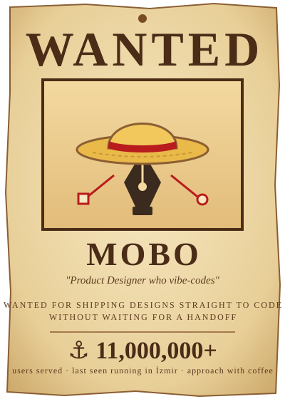

## 👒 Who's the captain

<table>
<tr>
<td width="38%" valign="top">

</td>
<td valign="top">

**Behdad Morsalpoor** · Mobo for short

- 🎨 **Product Designer & Design Lead**, 12+ years
- 💰 Fintech & crypto products for **11M+ users**
- 🤖 Designs with AI daily: **Figma → Claude Code → production**
- 🔬 Research nerd, **qual + quant**, data-driven
- 🎙️ Hosts a design podcast on HCI & cognitive science
- 🧑‍💻 Computer engineer by degree, so engineers trust me
- 📍 İzmir, Türkiye

> *Laugh a lot, trust the crew, keep sailing, even when the map is half blank.* 🏴‍☠️

</td>
</tr>
</table>

## 🧭 How I work

| Habit | What it looks like |
|---|---|
| 🤖 **AI-first** | From Figma to a working prototype with Claude Code, sometimes all the way to shipped code |
| 🔬 **Research first** | Interviews & usability tests **+** funnels, events & A/B tests. Both halves before deciding |
| 🧩 **Problem finder** | People bring me what's broken when nobody knows why. Name it well, and the fix gets easy |
| 🧱 **Edge-case hunter** | Feasibility and edge cases sorted with engineering & QA before release day |

## 🏝️ Treasure so far

| 🏆 Result | ⚓ The story |
|---|---|
| **48% → 58%** login success | A login flow failing 52% of the time, fixed in 3 research cycles |
| **4** micro-interactions shipped | Coded myself with Claude Code, next to the engineers, in 2 weeks |
| **138K** sign-ups in 24h | Launch-day experience that kept 80% of trades going at peak load |
| **+25%** Direct Debit adoption | Payment gateway review for **18K vendors** at Cafe Bazaar |
| **50% → 30%** bounce rate | Reworked information architecture for a US e-commerce client |

More stories on <a href="https://behdad.studio">behdad.studio</a> →

## 🛠️ What's on the ship

| Area | Tools |
|---|---|
| **Design** |  |
| **Build** |    |
| **Data** |    |

## 🍇 My devil fruit

> **The Vibe-Vibe Fruit.** Turns Figma frames into working code before sprint planning ends.
> **Weakness:** can't swim (in Python and JavaScript). Lessons in progress. 🏊

## 🔭 Next islands

`🎮 Gamification` · `📋 Product management` · `🧠 Computational cognitive science` · `🐍 Python` · `⚡ JavaScript`

## 📦 On deck

**[reporch](https://github.com/mobo-kun/reporch)**: Report of Research. An agent skill for Claude Code and Codex that turns raw user-research material into an **HTML report**, a **blog post** and a **PDF**.

## 🏃 Off the clock

- 🏃 **Runner.** Good run or slow run, both count.
- 🏴‍☠️ **One Piece fan.** Luffy is my captain. Nico Robin is my research hero: she reads the history nobody else can.
- 😂 **Known side effects:** laughing at error messages, asking *"but what does the data say?"* at dinner.

## 🤝 Join the crew

Need a designer who does the research, draws the flows **and** opens the terminal?
👉 [LinkedIn](https://linkedin.com/in/behdad-mor) · [behdad.studio](https://behdad.studio) · snacks for the crew appreciated 🍖

### *Progress is progress, no matter how much it is.* 🏃‍♂️

