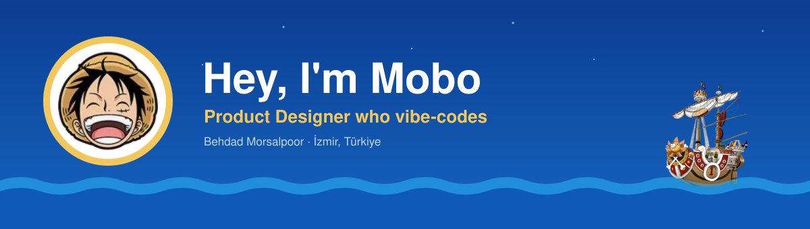
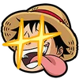
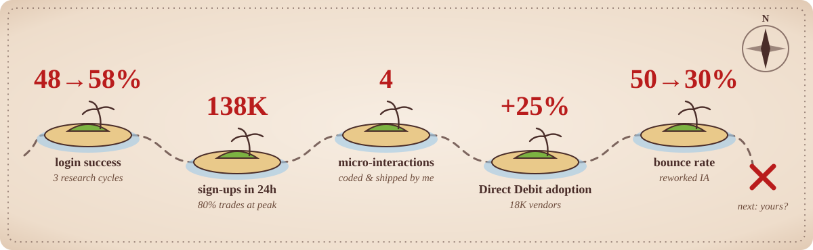
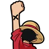
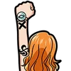
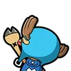

##  Who's the captain

<table>
<tr>
<td width="40%" valign="top"></td>
<td valign="top">

- 🎨 **Product Designer & Design Lead** · 12+ years
- 💰 **Fintech & crypto**: trading, payments, onboarding
- 🎙️ Hosts a **design podcast** on HCI & cognitive science
- 🧑‍💻 **Computer engineer** by degree, fluent in engineer
- 🏃 Runner, and a **One Piece** fan to the bone

> *Laugh a lot, trust the crew, keep sailing even when the map is half blank.*

</td>
</tr>
</table>

##  My crew, my habits

<table>
<tr>
<td width="50%" align="center" valign="top">
 
<b>The Captain · AI-first</b> 
I design with AI every day and ship real code, not just mockups.
</td>
<td width="50%" align="center" valign="top">
 
<b>The Archaeologist · Research first</b> 
Interviews and usability tests, plus funnels and A/B tests.
</td>
</tr>
<tr>
<td align="center" valign="top">
 
<b>The Swordsman · Problem finder</b> 
Zoro gets lost. I find the real problem nobody could name.
</td>
<td align="center" valign="top">
 
<b>The Sniper · Edge-case worrier</b> 
I worry about every edge case with engineering and QA, early.
</td>
</tr>
</table>

##  Treasure so far

Full logbook on <a href="https://behdad.studio">behdad.studio</a>

## 🧰 Ship's inventory

| Deck | Tools |
|:--|:--|
| **Design** |  |
| **Build** |    |
| **Data** |    |

<table>
<tr>
<td width="50%" valign="top">

###  Devil fruit

**The Vibe-Vibe Fruit.** Figma frames turn into working code. 
**Weakness:** can't swim in Python or JavaScript yet.

</td>
<td width="50%" valign="top">

###  Next islands

`🎮 Gamification` `📋 Product management` 
`🧠 Computational cognitive science` `🐍 Python` `⚡ JS`

</td>
</tr>
<tr>
<td colspan="2" valign="top">

###  On deck: [reporch](https://github.com/mobo-kun/reporch)

An agent skill for Claude Code and Codex that turns raw user research into an **HTML report**, a **blog post** and a **PDF**.

</td>
</tr>
</table>

##  Known side effects

- Laughing at error messages
- Asking *"but what does the data say?"* at dinner
- Counting a slow run as a good run

<h2 align="center">Join the crew</h2>

Need a designer who researches, draws the flows <b>and</b> opens the terminal? 
<a href="https://linkedin.com/in/behdad-mor"><b>Raise your arm on LinkedIn →</b></a> &nbsp;·&nbsp; <a href="https://behdad.studio">behdad.studio</a>

<h3 align="center"><i>Progress is progress, no matter how much it is.</i></h3>
